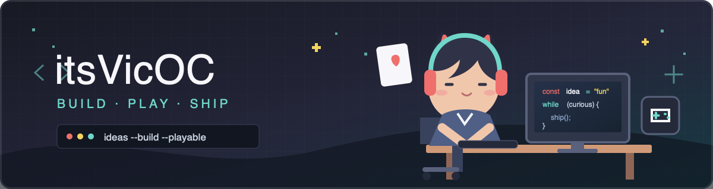
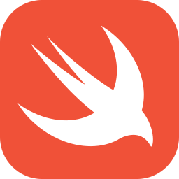
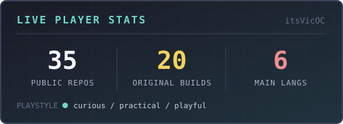
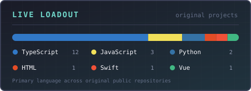

  

  <h3>把脑洞做成能玩的东西，把重复动作变成顺手的工具。</h3>

  
你好，我是 <strong>Vic</strong>。喜欢小游戏、效率工具，以及有一点性格的交互。

  

    <a href="#精选作品">精选作品</a> ·
    <a href="#技术栈">技术栈</a> ·
    <a href="#开源足迹">开源足迹</a> ·
    <a href="https://github.com/itsVicOC?tab=repositories">全部仓库</a>
  

---

## 关于我

我喜欢把一个模糊的想法，打磨到真正能运行、能交互、能交付。从终端里的掼蛋 AI，到浏览器中的塔防和每日谜题；从 GUI / CLI 双模式工具，到原生 macOS 和跨平台桌面应用。

- **游戏与互动**：把规则、策略和即时反馈，变成一段可以参与的体验。
- **工具与效率**：从真实使用场景出发，让重复操作更省心。
- **跨端探索**：Web、终端、桌面与小程序，选择适合问题的载体。

## 精选作品

### 游戏与互动

- **[guandan · 终端掼蛋](https://github.com/itsVicOC/guandan)** 
  本地 TUI 游戏，内置 5 档 AI，让复杂牌型与不同风格的对手在终端里相遇。 
  `Python` `TUI` `Game AI`

- **[PathForge TD · 迷宫塔防](https://github.com/itsVicOC/pathforge-td)** 
  在 Canvas 棋盘上规划路径、布置防线，把迷宫和塔防组合成可玩的策略实验。 
  `TypeScript` `Canvas` · **[在线体验 ↗](https://itsvicoc.github.io/pathforge-td/)**

### 桌面与效率

- **[bilibili-downloader · 桌面下载工具](https://github.com/itsVicOC/bilibili-downloader)** 
  同一套下载能力，提供 GUI 和 CLI 两种入口。 
  `Python` `Desktop` `GUI + CLI`

- **[MangaViewer · 本地漫画阅读器](https://github.com/itsVicOC/mangaViewer)** 
  管理本地漫画库与阅读进度，支持多种文件格式、双页和长条阅读。 
  `Tauri` `React` `TypeScript` `Rust`

### 资料与探索

- **[PolishedDex CN · 抛光水晶图鉴](https://github.com/itsVicOC/polishedDexCN)** 
  面向 Pokémon Polished Crystal 的中英双语资料库，串联图鉴、攻略与实用查询工具。 
  `TypeScript` `PWA` · **[打开图鉴 ↗](https://itsvicoc.github.io/polishedDexCN/)**

- **[汉字启蒙 · 亲子识字](https://github.com/itsVicOC/hanzi-study)** 
  用象形识字与字卡游戏，让家长陪孩子每天花一点时间，轻松认识汉字。 
  `TypeScript` `Web` · **[在线体验 ↗](https://itsvicoc.github.io/hanzi-study/)**

  
<strong>还有一些小作品，欢迎逛逛</strong>

   

  <ul>
    <li><a href="https://github.com/itsVicOC/gridGame">纸径</a>：带全球排行榜的每日路径拼图 · <a href="https://itsvicoc.github.io/gridGame/">在线体验</a></li>
    <li><a href="https://github.com/itsVicOC/sudoku">每日数独</a>：每日题目与共享排行榜 · <a href="https://itsvicoc.github.io/sudoku/">在线体验</a></li>
    <li><a href="https://github.com/itsVicOC/PokemonDeck">PokemonDeck</a>：由 PokeAPI 驱动的 Web 图鉴 · <a href="https://itsvicoc.github.io/PokemonDeck/">在线体验</a></li>
    <li><a href="https://github.com/itsVicOC/PaperTodo-macOS">PaperTodo macOS</a>：原生 AppKit 待办应用</li>
  </ul>

## 技术栈

**语言** · TypeScript / JavaScript / Python / Rust / Swift

  
  
  
  
  

**Web** · React / Vue / Vite / HTML / CSS

  
  
  
  
  

**桌面与工具** · Tauri / Git / GitHub / VS Code

  
  
  
  

## 开源足迹

  
  

  <a href="https://github.com/itsVicOC">查看贡献记录</a> ·
  <a href="https://github.com/itsVicOC?tab=repositories">探索全部作品</a> ·
  <a href="https://github.com/itsVicOC?tab=followers">关注与交流</a>

---

  <strong>好玩的想法值得被实现，好用的工具值得被分享。</strong>
  
BUILD · PLAY · SHIP — Thanks for stopping by.

